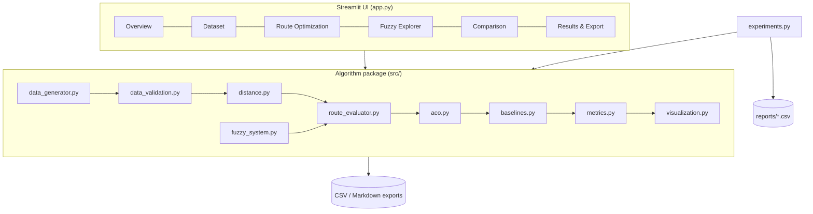
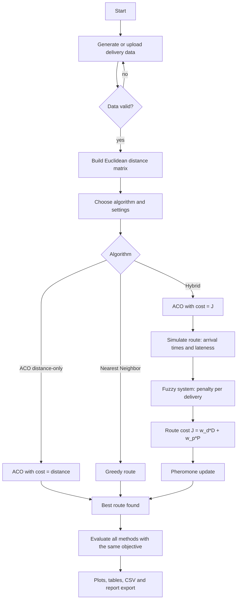
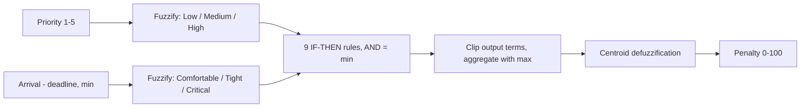

# QuickRoute: Intelligent Delivery Route Optimization Using Ant Colony Optimization and Fuzzy Logic


An academic Soft Computing project. One delivery vehicle starts at a depot, visits every customer once and
returns to the depot. **Ant Colony Optimization (ACO)** searches for good delivery orders and a
**Mamdani Fuzzy Logic** system turns *priority* and *deadline tightness* into a delay penalty. The
two are combined into one objective that balances **distance** and **weighted delivery delays**.

> This is a **simulation**. Coordinates are synthetic, distances are *simulated distance units (su)*.
> There is **no** GPS, live traffic or mapping API.

---

## 1. Abstract

Delivery routing is usually solved by minimising distance only, which can make urgent customers wait.
QuickRoute integrates ACO (implemented from scratch with NumPy) and a hand-built Mamdani fuzzy inference
system. ACO ants build routes using pheromone and inverse-distance information; each candidate route is
simulated to obtain arrival times and lateness; the fuzzy system converts every delivery's priority and
lateness into a penalty (0-100); and the route cost `J = w_d * normalised distance + w_p * normalised penalty`
drives the pheromone update. The hybrid method is compared with Nearest Neighbor and distance-only ACO
(and a brute-force optimum on a small instance) using repeated runs with different random seeds.

## 2. Problem statement

Given a depot and *n* customers, each with coordinates, priority (1-5), service time and deadline, find a
visiting order of one vehicle that is short **and** serves late-sensitive, high-priority customers on time.
Visiting order matters because arrival times depend on the order.

## 3. Objectives

1. Generate or load deliveries; compute a Euclidean distance matrix.
2. Optimise delivery order with ACO implemented from scratch.
3. Estimate arrival times and lateness; apply Fuzzy Logic to compute penalties.
4. Combine distance and penalty in one fitness function.
5. Compare with simpler baselines; report honest, reproducible metrics.
6. Provide a dashboard with route plots, convergence plots and CSV/report export.

## 4. Scope and limitations

**Implemented**
- Single vehicle, closed tour, 1-50 deliveries (10-30 recommended), no capacities.
- Synthetic dataset generator, CSV upload/download and validation.
- ACO (Ant System + optional elitist boost), pure-Python Mamdani FIS, route evaluator.
- Baselines: Nearest Neighbor, distance-only ACO, brute force (max 8 deliveries).
- Repeated-seed experiments (mean and standard deviation), 6-page Streamlit dashboard, 59 automated tests.

**Limitations**
- Synthetic data, simulated distances; no road network, traffic, or real GPS.
- Vehicle does **not wait** if it arrives early (arrival time is compared with the deadline only).
- ACO is a heuristic and does **not** guarantee the global optimum.
- Results depend on the dataset, the seeds, the fuzzy design and the weights; the experiments shown use one
  generated dataset (seed 42), so they are an illustration, not a general proof.
- Centroid defuzzification is not perfectly monotone: the penalty can dip by up to ~3.5 points along the
  lateness axis and ~6.3 points along the priority axis (see `reports/methodology.md`).

**Future work (not implemented)** - see section 17.

## 5. Existing approach and proposed approach

| | Existing (typical) | Proposed (QuickRoute) |
|---|---|---|
| Objective | Shortest distance (TSP) | Distance **and** fuzzy delay penalty |
| Priority / deadlines | Ignored or crisp "late / not late" | Fuzzy: gradual, depends on priority and how close/late the arrival is |
| Search | Greedy (Nearest Neighbor) or exact (small n) | ACO with pheromone learning |
| Evaluation | One run | Repeated seeds, mean +- std, same objective for all methods |

## 6. System architecture



## 7. Full system flowchart



## 8. Algorithm explanations

### 8.1 Ant Colony Optimization (aco.py)

* **Pheromone matrix** `tau`: initialised to a positive constant, diagonal = 0 (no self-transitions).
* **Heuristic** `eta(i,j) = 1 / (d(i,j) + epsilon)`, `epsilon = 1e-9`.
* **Transition probability** for an ant at `i` choosing among unvisited `j`:

  `P(i,j) = tau(i,j)^alpha * eta(i,j)^beta / sum_k tau(i,k)^alpha * eta(i,k)^beta`
* **Route construction**: start at the depot, choose unvisited customers by roulette wheel, return to the depot.
* **Pheromone update**: `tau(i,j) <- (1 - rho) * tau(i,j) + delta_tau(i,j)` where each ant deposits
  `Q / cost(route)` on its edges (lower cost -> more pheromone) and the best-so-far route gets an extra
  `elitist_weight * Q / cost_best`. Values are clipped to `[1e-6, 1e6]` for numerical stability.
* **Distance-only ACO and hybrid ACO use the same code**; only the cost function differs.

```mermaid
flowchart TD
    S[Initialise pheromone tau0, heuristic eta] --> I{Iteration <= max?}
    I -- no --> R[Return best route]
    I -- yes --> A[For each ant: build route from depot]
    A --> N[Choose next customer with probability P_ij]
    N --> M{All customers visited?}
    M -- no --> N
    M -- yes --> C[Return to depot, compute cost]
    C --> B[Update best-so-far]
    B --> E[Evaporate: tau = (1 - rho) * tau]
    E --> D[Deposit Q / cost on each ant's edges + elitist boost]
    D --> I
```

### 8.2 Fuzzy Logic (fuzzy_system.py)

Mamdani FIS written directly in NumPy (no scikit-fuzzy; see `reports/methodology.md` for the reasons).

| Variable | Universe | Terms (trapezoid a,b,c,d) |
|---|---|---|
| Priority | 1-5 | Low (1,1,2,3), Medium (2,3,3,4), High (3,4,5,5) |
| Lateness = arrival - deadline (min). **Positive = missed deadline** | -60..120 | Comfortable (-60,-60,-30,0), Tight (-30,0,0,60), Critical (0,60,120,120) |
| Penalty | 0-100 | Low (0,0,10,30), Medium (15,40,40,65), High (45,70,70,90), Very high (70,90,100,100) |

**Rule base (9 rules, every input combination covered)**

| Priority \ Deadline | Comfortable | Tight | Critical |
|---|---|---|---|
| Low | Low | Low | Medium |
| Medium | Low | Medium | High |
| High | Low | High | Very high |

Operators: AND = min, implication = min (clipping), aggregation = max, defuzzification = centroid.
**How priority influences the penalty:** for the same lateness, a higher priority fires rules with a larger
output term (e.g. Critical: Low->Medium, Medium->High, High->Very high), so the same delay costs more.



### 8.3 Pseudocode

**ACO**
```
initialise tau[i][j] = tau0 (i != j), tau[i][i] = 0;  eta[i][j] = 1 / (d[i][j] + eps)
best = None
for iteration in 1..N_iterations:
    for ant in 1..N_ants:
        route = []; current = depot; unvisited = all customers
        while unvisited not empty:
            weight[j] = tau[current][j]^alpha * eta[current][j]^beta   for j in unvisited
            pick j with probability weight[j] / sum(weight)
            route.append(j); remove j from unvisited; current = j
        cost[ant] = cost_function(route)        # distance, or hybrid objective J
        if cost[ant] < best.cost: best = (route, cost[ant])
    tau = (1 - rho) * tau                        # evaporation
    for each ant: add Q / cost[ant] to every edge of [depot] + route + [depot]
    add elitist_weight * Q / best.cost to the edges of best.route
    clip tau into [1e-6, 1e6]
return best
```

**Fuzzy penalty of one delivery**
```
x = clip(arrival - deadline, -60, 120);  p = clip(priority, 1, 5)
mu_priority[t]  = membership(p, t)     for t in {Low, Medium, High}
mu_deadline[t]  = membership(x, t)     for t in {Comfortable, Tight, Critical}
for each rule (pt, dt -> out):  strength = min(mu_priority[pt], mu_deadline[dt])
                                level[out] = max(level[out], strength)
shape(y) = max over out of min(membership_out(y), level[out])
penalty = sum(y * shape(y)) / sum(shape(y))      # centroid
```

**Route evaluation**
```
clock = 0
for each leg (prev -> node) of [depot] + order + [depot]:
    clock += d[prev][node] / speed                # arrival
    if node != depot:
        signed = clock - deadline[node];  lateness = max(0, signed)
        penalty[node] = fuzzy(priority[node], signed)
        clock += service_time[node]
D = total distance;  P = sum(penalty)
J = w_d * D / D_ref + w_p * P / P_ref
```

## 9. Mathematical formulas

* Distance: `d(i,j) = sqrt((x_i - x_j)^2 + (y_i - y_j)^2)` (simulated distance units).
* Arrival: `arrival_j = departure_i + d(i,j) / speed`; `departure_j = arrival_j + service_j`.
* Lateness: `lateness_j = max(0, arrival_j - deadline_j)`; fuzzy input is the signed value `arrival_j - deadline_j`.
* Objective: `J(route) = w_d * D / D_ref + w_p * P / P_ref`, minimise J.
  * `D` = route distance, `P` = sum of fuzzy penalties.
  * `D_ref = 2 * sum_i d(depot, i)` (star-tour length) and `P_ref = 100 * n` are **fixed for a dataset**, so every
    candidate route is normalised identically (never per route).
  * Weights must be >= 0 and `w_d + w_p = 1` (validated; the sidebar derives `w_p = 1 - w_d`).
* Improvement (lower-is-better metrics): `improvement % = (baseline - method) / baseline * 100`
  (positive = better than the baseline; NaN if the baseline is 0).

## 10. Dataset schema

| Column | Meaning |
|---|---|
| `delivery_id` | Unique ID (depot = 0) |
| `location_name` | Text label |
| `x_coordinate`, `y_coordinate` | Position on a 100 x 100 simulated map (simulated distance units) |
| `priority` | Integer 1 (low) - 5 (high) |
| `service_time_minutes` | Time spent at the customer |
| `delivery_deadline_minutes` | Latest desirable arrival time (minutes after the vehicle leaves at time 0) |
| `package_size` | Optional text (Small / Medium / Large) |
| `is_depot` | True for exactly one row |

Deadlines are generated as *direct travel time + service time + random slack*, with tighter slack for
priority 4-5. `data/sample_deliveries.csv` is the default dataset (15 deliveries, seed 42).
Validation catches missing values, duplicate IDs, non-numeric / infinite / out-of-range coordinates,
priorities outside 1-5, missing columns, a wrong number of depots, and empty or malformed CSV files.

## 11. Installation on Windows 11 (VS Code)

1. Install **Python 3.11+** from python.org (tick *Add python.exe to PATH*) and **VS Code** with the *Python* extension.
2. Open the `quickroute` folder in VS Code (*File -> Open Folder*), then open a terminal (*Terminal -> New Terminal*, PowerShell).
3. Create and activate a virtual environment, then install dependencies:

```powershell
python -m venv .venv
.venv\Scripts\Activate.ps1
python -m pip install --upgrade pip
pip install -r requirements.txt
```

If PowerShell blocks the activation script, run once:
`Set-ExecutionPolicy -Scope CurrentUser RemoteSigned`, or use `.venv\Scripts\activate.bat` in Command Prompt.
In VS Code choose the interpreter with *Ctrl+Shift+P -> Python: Select Interpreter -> .venv*.

4. Launch the application:

```powershell
streamlit run app.py
```

The browser opens at `http://localhost:8501`.

## 12. Running tests and experiments

```powershell
python -m pytest -q                      # 59 tests
python experiments.py                    # main comparison + small-instance check, writes reports/*.csv
python experiments.py --sensitivity      # additionally a weight-sensitivity study on a separate dataset
python experiments.py --seeds 20 --deliveries 20 --dataset-seed 7
```

The tests cover: symmetric distance matrix with zero diagonal; depot at start and end; each delivery visited
exactly once; finite, in-range fuzzy output; hand-calculated arrival times and lateness; weights used correctly;
ACO returns valid routes (including 1 delivery); invalid CSV files and invalid parameters give clear errors;
and every dashboard page renders (Streamlit `AppTest`).

## 13. Dashboard guide and screenshots to capture

| Page | What it does | Screenshot for the report |
|---|---|---|
| 1 Project Overview | Description, objectives, workflow diagram, assumptions | Workflow diagram |
| 2 Dataset Management | Generate / upload / download / validate, location scatter plot | Data table + scatter plot |
| 3 Route Optimization | Pick algorithm, run with progress bar, route on Plotly map, convergence | Route map (green = on time, red = late) |
| 4 Fuzzy Logic Explorer | Membership plots, rule table, live inference, explanation | Membership plots; one inference with activated rules |
| 5 Algorithm Comparison | Repeated runs, mean +- std table, improvement table, bar / scatter / convergence plots | Comparison table and plots |
| 6 Results and Export | Route sequence, delivery-level arrival and delay, CSV / report downloads | Delivery-level table |

## 14. Experimental methodology

* Same dataset, same closed-tour assumptions and the **same evaluation objective J** for every method.
* Nearest Neighbor is deterministic (one run). Distance-only ACO and hybrid ACO are run with seeds 0..9.
  Tables report **mean +- standard deviation over those runs**; a single dashboard run is a one-run result.
* Brute force (n <= 8) gives the true optimum of J on a small instance for reference.
* **Avoiding leakage:** the weights (0.5/0.5) and ACO parameters are fixed defaults chosen before looking at results.
  The optional sensitivity study uses a *different* dataset (seed 7) and only describes the trade-off; it is not used
  to pick settings for the evaluation dataset.
* Nothing is hard-coded: all numbers come from `python experiments.py`.

## 15. Results

### 15.1 Results table template (fill from the dashboard or `reports/results_summary.csv`)

| Method | Runs | Distance (su) | Total lateness (min) | Late deliveries | Fuzzy penalty (sum) | Objective J | Time (s) |
|---|---|---|---|---|---|---|---|
| Nearest Neighbor | 1 | | | | | | |
| ACO Distance-Only | n | mean +- std | | | | | |
| Hybrid ACO + Fuzzy | n | mean +- std | | | | | |

### 15.2 Results produced by `python experiments.py` in the development environment

Default settings: 15 deliveries, dataset seed 42, w_d = w_p = 0.5, speed 1 su/min, 20 ants, 100 iterations,
ACO seeds 0-9. Re-running gives the same numbers on the same library versions; times will differ by machine.

| Method | Runs | Distance (su) | Total lateness (min) | Late deliveries | Fuzzy penalty (sum) | Objective J |
|---|---|---|---|---|---|---|
| Nearest Neighbor | 1 | 383.52 | 233.7 | 3 | 360.7 | 0.294 |
| ACO Distance-Only | 10 | 309.12 +- 6.48 | 331.2 | 3.8 | 404.1 | 0.275 +- 0.006 |
| Hybrid ACO + Fuzzy | 10 | 341.48 +- 12.07 | 324.6 | 2.0 | 270.8 | 0.245 +- 0.006 |

Improvement of the hybrid method (positive = better): objective J +16.7% vs Nearest Neighbor and +10.8% vs
distance-only ACO; late deliveries -47% vs distance-only ACO (2.0 vs 3.8); fuzzy penalty -33% vs distance-only ACO;
route distance is **10.5% longer** than distance-only ACO. Total lateness in minutes is about 2% lower than
distance-only ACO but **39% higher than Nearest Neighbor** on this dataset, because the objective penalises
priority-weighted fuzzy urgency, not raw minutes.

Small-instance check (8 deliveries): hybrid ACO matched the brute-force optimum of J in 10 of 10 seeds.

**Interpretation and caution.** The hybrid method wins on J, the quantity it optimises, so that comparison is
expected to favour it; the more meaningful evidence is the trade-off (fewer late and lower-penalty deliveries for a
longer route). One dataset and 10 seeds is an illustration, not proof of general superiority. Try other
dataset seeds and weights (`reports/results_weight_sensitivity.csv`, produced with `--sensitivity`).

## 16. Viva questions (20) with short answers

1. **What problem does QuickRoute solve?** Ordering the stops of one delivery vehicle so the route is short and urgent customers are served on time.
2. **Which Soft Computing techniques are used?** Ant Colony Optimization and Mamdani Fuzzy Logic.
3. **What is ACO?** A population-based metaheuristic where artificial ants build solutions guided by pheromone trails and a heuristic, inspired by real ants.
4. **What are tau and eta?** tau is the pheromone level on an edge (learned experience); eta = 1/distance is the heuristic desirability.
5. **Write the transition probability.** P(i,j) = tau^alpha * eta^beta / sum over unvisited k of tau(i,k)^alpha * eta(i,k)^beta.
6. **What do alpha and beta control?** alpha: how much ants trust pheromone; beta: how much they prefer short edges (greedy).
7. **Why does pheromone evaporate?** To forget poor early choices, avoid premature convergence and keep numbers bounded.
8. **How do better routes deposit more pheromone?** Each ant deposits Q / cost, so a lower cost gives a bigger deposit.
9. **What is the elitist boost?** Extra pheromone on the best-so-far route to speed up convergence (set it to 0 to switch off).
10. **Does ACO guarantee the optimal route?** No. It is a heuristic; we only verified it matches brute force on a small instance.
11. **Why fuzzy logic instead of "late = 1, on time = 0"?** Lateness is gradual: 2 minutes late for a low-priority parcel is not the same as 60 minutes late for a high-priority one.
12. **What are the fuzzy inputs and output?** Inputs: priority (1-5) and arrival - deadline in minutes (positive = late). Output: penalty 0-100.
13. **What is Mamdani inference?** Fuzzify inputs, evaluate IF-THEN rules (AND = min), clip each output set, aggregate (max), defuzzify (centroid).
14. **What is the centroid method?** The x-coordinate of the centre of area of the aggregated output shape.
15. **How does priority affect the penalty?** Higher priority fires rules with larger output terms, so the same lateness costs more (High+Critical -> Very high).
16. **Why implement the FIS yourself?** It is fast (called thousands of times), has no fragile dependency, and every step can be shown in the viva.
17. **What is the objective function?** J = w_d * D/D_ref + w_p * P/P_ref; weights are >= 0 and sum to 1.
18. **Why fixed reference scales D_ref and P_ref?** Normalising each route separately would make J values incomparable; fixed scales keep the objective consistent.
19. **How do you compare the algorithms fairly?** Same data, same assumptions, same J; ACO is repeated over seeds and mean +- std is reported.
20. **What are the main limitations?** Synthetic data, single vehicle, no waiting/traffic/capacity, heuristic search, small fuzzy ripples, results from one dataset.

## 17. Limitations and future improvements

| Implemented | Proposed future work (not implemented) |
|---|---|
| Single vehicle, closed tour | Multiple vehicles and capacity constraints (VRP) |
| Euclidean simulated distance | Real road distances / traffic (would need external data) |
| Deadlines compared with arrival time | Time windows with waiting, break times |
| Fixed fuzzy rules and membership functions | Tuning the fuzzy design with separate training data (e.g. genetic algorithm) |
| ACO with distance heuristic | Deadline-aware heuristic, MAX-MIN Ant System, local search (2-opt) |
| Tests on 1-15 deliveries | Larger benchmark instances and statistical significance tests |

## 18. Project structure

```
quickroute/
  app.py                    Streamlit dashboard (UI only)
  experiments.py            command-line experiments -> reports/*.csv
  requirements.txt  pytest.ini  conftest.py
  data/sample_deliveries.csv
  src/  data_generator.py data_validation.py distance.py fuzzy_system.py route_evaluator.py
        aco.py baselines.py metrics.py visualization.py
  tests/  test_distance.py test_fuzzy_system.py test_route_evaluator.py test_aco.py
          test_data_validation.py test_app_smoke.py helpers.py
  reports/ methodology.md  results_*.csv
```
